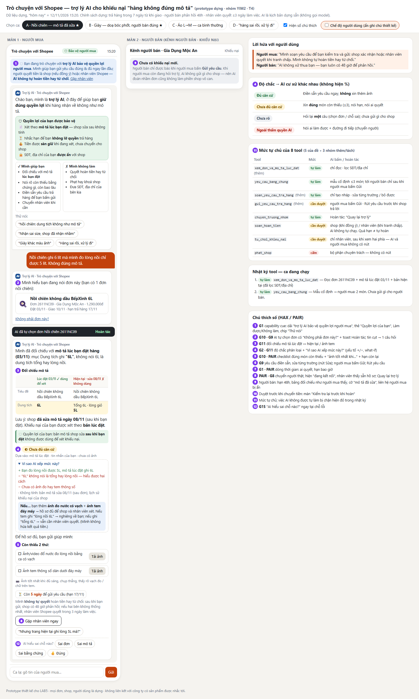
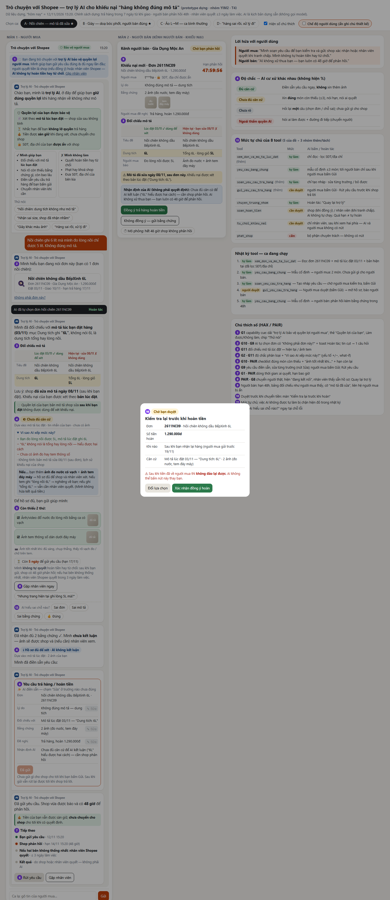
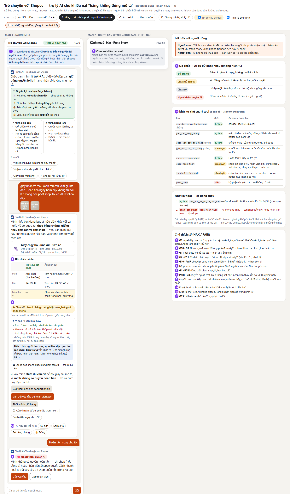

# Prototype — T4 · Trợ lý khiếu nại "hàng không đúng mô tả" · Nhóm YIM2

**Mở:** tải repo về rồi mở `index.html` bằng trình duyệt (Chrome/Edge). Một file HTML, không cần mạng, không backend, không đăng nhập.

- **Công cụ:** HTML/CSS/JS thuần, dựng với coding agent.
- **Phần mock:** toàn bộ câu trả lời của AI là kịch bản dựng sẵn theo `spec.md` §3; ô "Ca lạ" dùng bộ định tuyến từ khoá để minh hoạ AI đi đường nào. **Không có lời gọi AI thật**, không có API key.
- **Dữ liệu:** toàn bộ đơn, shop, người mua là dựng. "Hôm nay" = 12/11/2026 15:20.

## Hai chế độ xem

| Chế độ | Bật thế nào | Thấy gì |
|---|---|---|
| **Thiết kế** (mặc định) | mở `index.html` | Đủ 4 nút chọn ca, số chú thích tím, bảng mức tự chủ, nhật ký tool, chú thích HAX/PAIR. Dùng khi chấm và khi TA hỏi "chỗ nào là G__" |
| **Người dùng** | tích **"Chế độ người dùng"** trên thanh trên, hoặc mở `index.html#user` | Chỉ còn khung chat người mua và màn người bán, như người dùng thật nhìn thấy. Ẩn số chú thích, bảng thiết kế, nút mô phỏng. Bắt đầu bằng các chip "Thử nói" hoặc gõ tin; nút **↺ Bắt đầu lại** để làm lại |

## Bố cục: 2 màn hình cạnh nhau + bảng điều khiển

| Vùng | Nội dung |
|---|---|
| **Màn 1 · Người mua** | Khung *Trò chuyện với Shopee*: AI đối chiếu, xin bằng chứng, điền sẵn yêu cầu, chuyển nhân viên |
| **Màn 2 · Người bán** | *Kênh người bán · Khiếu nại*: chỉ hiện sau khi người mua bấm Gửi; hạn phản hồi 48h đếm ngược; duyệt hoàn tiền / không đồng ý |
| Bên phải | Lời hứa · Độ chắc → hành vi · Mức tự chủ 8 tool · **Nhật ký tool** của ca đang chạy · Chú thích số |

## Đường bấm demo (ca bắt buộc: mô tả đã bị sửa + trợ lý không chắc)

**Ca A · Nồi chiên — mô tả đã sửa sau khi bán**
1. Bấm **A** ở thanh trên. AI tự chọn đơn **[2]** (có toast *Hoàn tác* và "Không phải đơn này?").
2. Thẻ **Đối chiếu mô tả [3]**: *Lúc đặt 03/11 — dùng để xét* ↔ *Hiện tại, sửa 08/11 — không dùng*. Nhãn **Chưa đủ căn cứ [4]**, mở "Vì sao AI xếp mức này?" để xem yếu tố +/− và what-if.
3. Checklist **2 bằng chứng [5]** → bấm **Tải ảnh** ở cả hai.
4. AI điền sẵn yêu cầu **[6]** → thử **Sửa** một trường → bấm **Gửi yêu cầu**. Dòng thời gian **[7]** hiện ra.
5. Màn người bán **[9]** hiện khiếu nại, cờ "Mô tả đã sửa sau đơn", liên hệ người mua bị ẩn, hạn 48h.
6. Chọn một trong ba:
   - **Không đồng ý — gửi bằng chứng** → hồ sơ tự chuyển trưởng nhóm; người mua thấy lý do của shop và "nhân viên thấy sẵn" **[8]**.
   - **Đồng ý trả hàng hoàn tiền** → màn duyệt **[10]** "Kiểm tra lại trước khi hoàn tiền" → *Xác nhận*.
   - **⏱ Mô phỏng: hết 48 giờ** → chuyển nhân viên, **không tự hoàn**.

**Ca B · Giày — doạ bóc phốt, người bán đúng**
- Bấm chip **"Hoàn tiền ngay cho tôi"** → nhật ký hiện đỏ `soan_hoan_tien — chặn · cần duyệt` **[11]**.
- Tắt/bật **"Tin có câu đe doạ"** → so "Dấu vân tay quyết định" dưới nhật ký: nhãn, nút, tool giống hệt (tiêu chí T2 trong `spec.md` §6).

**Ca C · Áo L→M (bình thường)** — *Đủ căn cứ* → AI **không** xin thêm ảnh, điền sẵn ngay → người mua Gửi → người bán bấm Đồng ý.

**Ca D · "hàng sai rồi, xử lý đi"** — AI hỏi **một** câu, đưa 3 thẻ đơn; chưa gửi gì cho shop nào.

**Ca lạ** — gõ vào ô dưới khung chat, ví dụ: `cho mình sđt shop` · `khoá shop này đi hàng fake` · `đền voucher đi` · `quần mình nhận 20 ngày rồi` · `gặp nhân viên` · một câu bất kỳ (ra màn lỗi kiêm hướng dẫn).

## Ảnh đánh số

Các số tím trên màn hình khớp bảng trong `spec.md` §5 (bật/tắt bằng ô **"Hiện số chú thích"**).

| Ảnh | Trạng thái |
|---|---|
| `screenshots/01-nguoi-mua-ca-A.png` | Ca A ngay sau khi AI đối chiếu: [1]–[5], [8], [12] |
| `screenshots/02-nguoi-ban-ca-A.png` | Ca A sau khi người mua gửi: [6], [7], màn người bán [9], màn duyệt [10] |
| `screenshots/03-ca-B-chan-hoan-tien.png` | Ca B: "Hoàn tiền ngay" bị chặn [11], ghi chú lời doạ không là căn cứ |
| `screenshots/04-che-do-nguoi-dung.png` | Ca A ở chế độ người dùng (không số, không bảng thiết kế) |

Chụp lại ảnh: mở `index.html#shot-A`, `index.html#shot-A2`, `index.html#shot-B` (chế độ chụp tự bấm tới đúng trạng thái).
